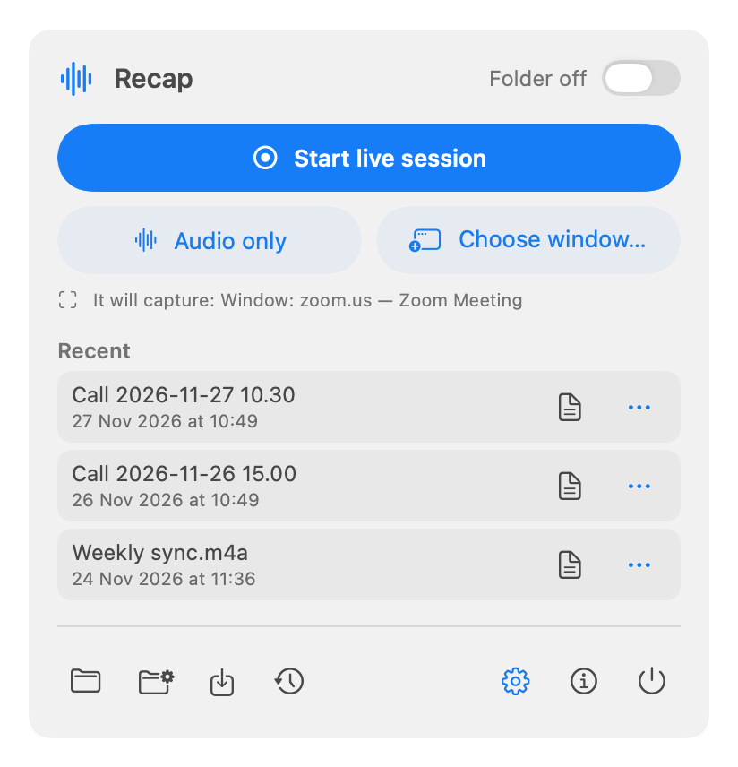

  

# Recap

Record, transcribe and summarize your calls on macOS — on-device by default.

  

Recap lives in the menu bar: it records calls (system audio + microphone, with or without screen video), watches a folder for new recordings, transcribes them with the built-in macOS speech engine, writes organized Markdown notes, and compresses videos with a never-larger-than-the-original guarantee. Apple Shortcuts integration on both ends.

- **App source and full documentation:** [app/README.md](app/README.md) · [italiano](app/README.it.md)
- **Build:** `app/scripts/build.sh` · **Package (DMG):** `app/scripts/package.sh`
- **Requirements:** macOS 26+, Xcode 26 to build
- **License:** [MIT](LICENSE)

`legacy/` contains the original Python prototype this app replaced.
