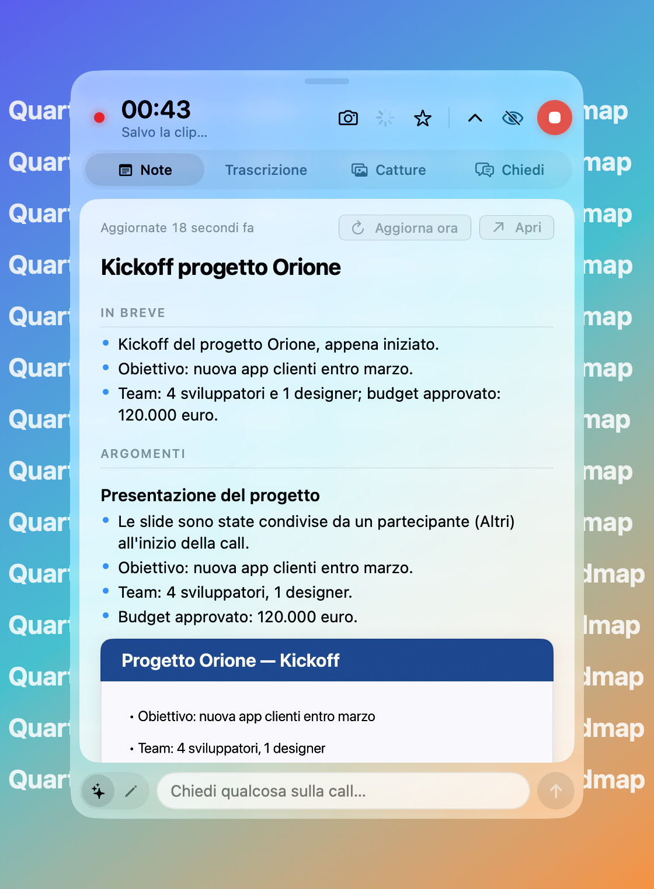
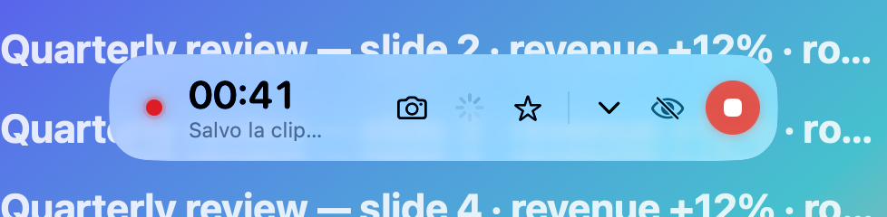
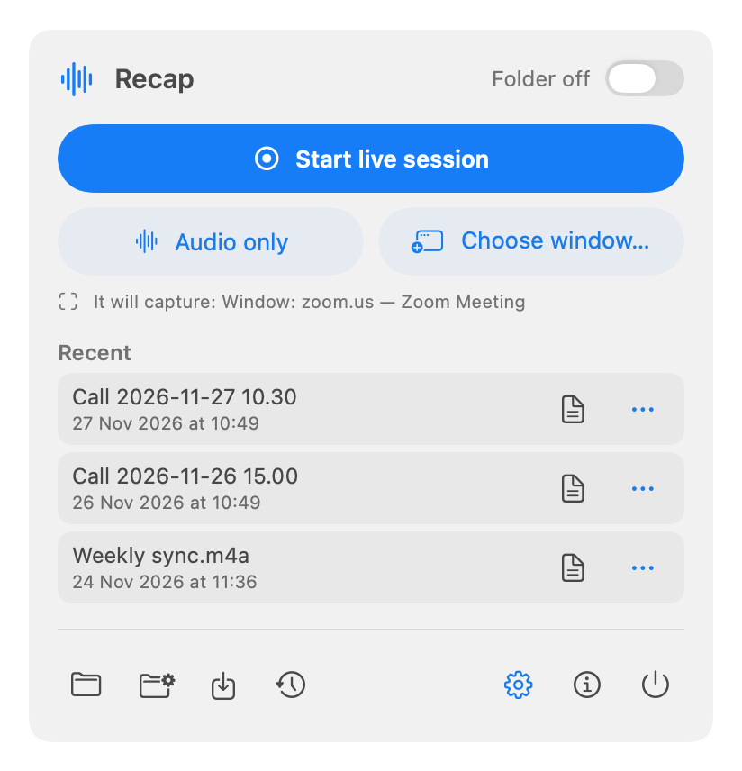
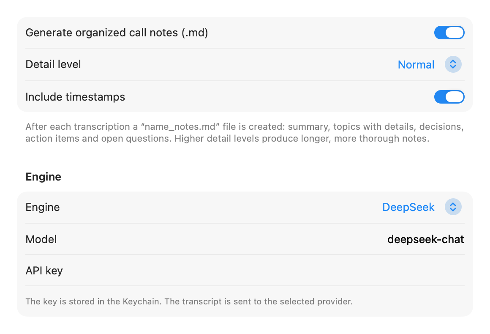
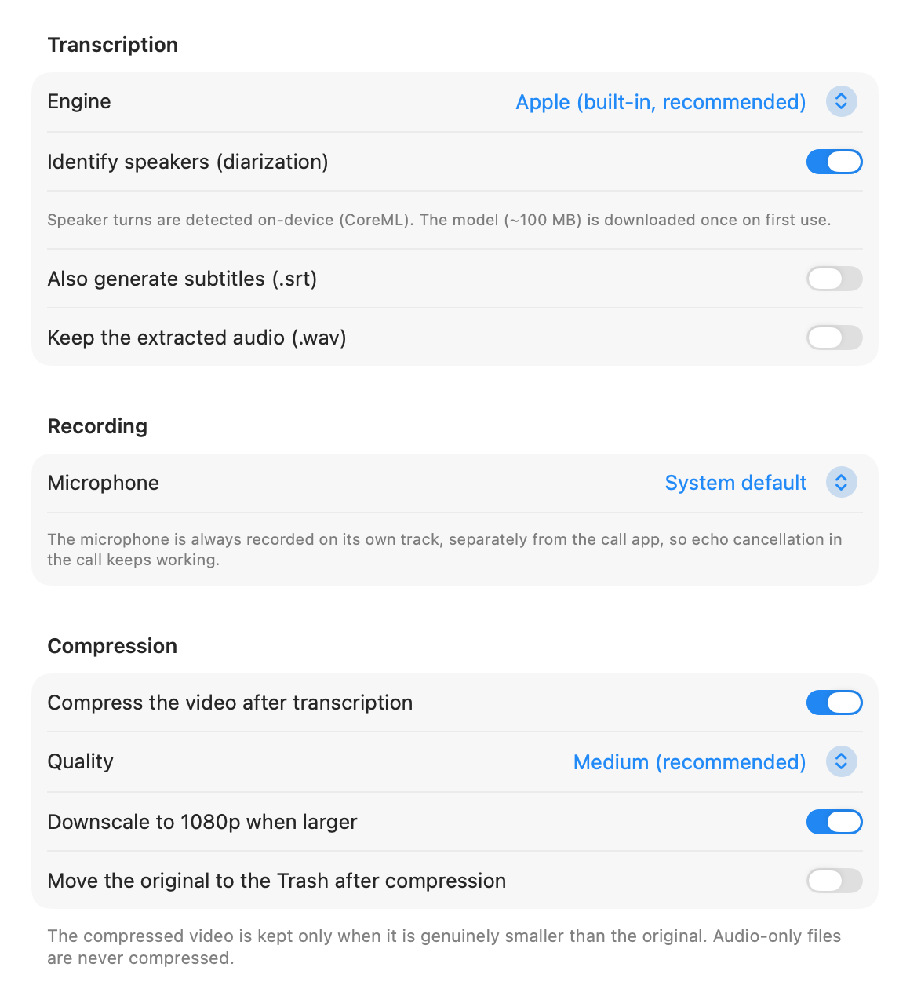
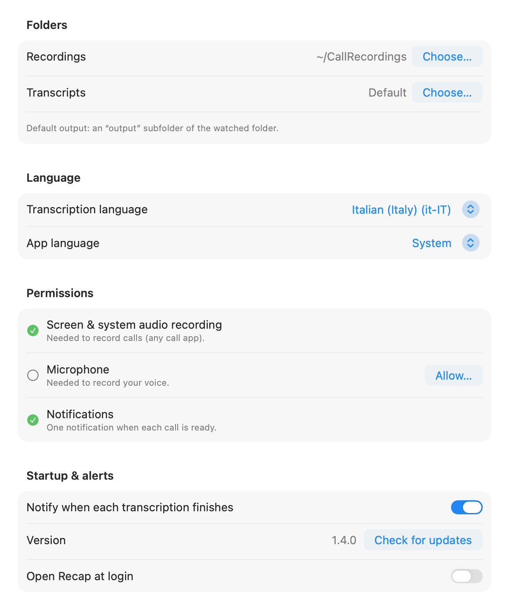

# CallT

*[English](README.md)*

App macOS (menu bar) che registra, trascrive e riassume le tue call — tutto on-device per impostazione predefinita.

Metti un video o un audio nella cartella osservata (o premi **Registra chiamata**) e CallT produce automaticamente trascrizione, note organizzate in Markdown e una copia compressa HEVC del video.

## Sessione live

Avvia una sessione (**Avvia sessione live** o ⌥⌘R) all'inizio della call. CallT:

- **trascrive mentre parlate**, separando la tua voce ("Io", dal microfono) da quella degli altri ("Altri", dall'audio di sistema). A fine call la diarizzazione on-device distingue i singoli partecipanti;
- **cattura la finestra della call** (Zoom, Teams, Meet nel browser…, oppure lo schermo col puntatore) e **salva da solo uno screenshot** quando lo schermo condiviso cambia: solo schermate con testo leggibile (slide, documenti, demo), con OCR on-device;
- tiene un **buffer circolare** per le **clip**: ⌃⌥C salva gli ultimi 30 s più i 10 s successivi. Il video integrale non serve (facoltativo);
- **scrive le note mentre la call va avanti** con Claude, che vede trascrizione e screenshot. A fine call una passata finale (Opus) produce il documento completo, con le immagini inserite dove servono;
- mostra un **pannello galleggiante** traslucido (Liquid Glass): compatto (timer e azioni rapide) o espanso (note, trascrizione, catture, chat per fare domande o aggiungere note tue). Si trascina, si nasconde con ⌃⌥N o dal menu, si nasconde da solo quando condividi lo schermo ed è escluso dalle catture;
- salva tutto in una cartella per call: `…_notes.md` (con `assets/` per immagini e clip), trascrizione, `session.json` ed eventualmente la registrazione completa.

**Motori AI**: *Claude — account locale* usa la CLI `claude` già collegata al tuo piano (nessuna chiave API); in alternativa la Claude API, oppure il motore delle note (es. DeepSeek, solo testo: gli screenshot arrivano come OCR), oppure nessuna AI.

Scorciatoie: ⌥⌘R avvia/ferma · ⌃⌥N pannello · ⌃⌥S screenshot · ⌃⌥C clip · ⌃⌥M segna il momento.

| Pannello | Compatto |
|---|---|
|  |  |

Collaudo senza call: `CallT --live-replay registrazione.mp4 [--speed 2] [--live-test-actions] [--quit-after-session]` rilegge un file come se fosse una call in corso.

## Funzionalità

- **Registrazione delle call** (ScreenCaptureKit): audio di sistema di *qualsiasi* strumento (Zoom, Meet, Teams…) più il microfono, sempre su una traccia separata via AVCapture (la cancellazione dell'eco della call non viene toccata) — con video dello schermo oppure solo audio.
- **Identificazione dei parlanti (diarizzazione)** — tutta on-device (CoreML via FluidAudio): la trascrizione diventa turni "Speaker 1/2/…" e le note attribuiscono posizioni e affermazioni a ciascun partecipante, usando i nomi reali quando emergono dalla conversazione.
- **Trascrizione on-device** col motore vocale di macOS 26 (lo stesso di Note e Memo Vocali) — nessuna dipendenza esterna. In alternativa usa `whisper-cli` + modello ggml se installati.
- **Note organizzate (.md)**: dopo ogni trascrizione — sintesi, argomenti con dettagli e timestamp, decisioni, azioni, domande aperte, nella lingua della call. Motori: Apple Intelligence on-device (default, gratuito, map/reduce per call lunghe), Claude con l'account locale di Claude Code, Claude API, OpenRouter, DeepSeek, Ollama locale o endpoint OpenAI-compatibile (chiavi API nel Portachiavi).
- **Compressione HEVC intelligente**: bitrate calcolato dal sorgente (mai oltre il 65% dell'originale), downscale opzionale a 1080p, e garanzia che il file compresso venga tenuto solo se davvero più piccolo.
- **Comandi Apple, in entrambe le direzioni**: esecuzione di un Comando con la trascrizione a fine call (delivery via mail/Slack/Note/…) e azione "Trascrivi video" esposta all'app Comandi Rapidi (App Intents).
- **Cartella osservata** con registro persistente (niente doppioni tra riavvii), coda seriale, notifiche, impostazioni persistenti, interfaccia inglese/italiano.
- Anche i file solo-audio (m4a, mp3, wav, aiff, flac) vengono trascritti — memo vocali benvenuti.
- MKV supportato se ffmpeg è installato (AVFoundation non lo legge).

## Screenshot

| Menu | Motori delle note |
|---|---|
|  |  |

| Elaborazione | Generale |
|---|---|
|  |  |

Gli screenshot sono renderizzati direttamente dalla UI reale: `CallT --render-screenshots <dir>`.

## Requisiti

- macOS 26 (Tahoe) o successivo. Xcode 26 per compilare.

## Installazione

Scarica `CallT.dmg` dalle release e trascina CallT in Applicazioni — oppure usa Homebrew:

```sh
brew install --cask anhonestboy/tap/callt
```
 Al primo avvio macOS blocca le app non firmate: **Impostazioni di Sistema → Privacy e Sicurezza → Apri comunque** (una sola volta). Per registrare le call verranno chiesti anche i permessi di Registrazione schermo/audio di sistema e Microfono.

Oppure compila dai sorgenti:

```sh
scripts/build.sh              # build arm64 → build.noindex/CallT.app
scripts/build.sh --universal  # arm64 + x86_64
scripts/package.sh            # build universale + build.noindex/CallT.dmg distribuibile
```

La build è una pipeline `swiftc` manuale (compila, impacchetta, estrae i metadati App Intents con `appintentsmetadataprocessor`, firma ad-hoc): non richiede `xcodebuild`. Per lavorare in Xcode, `xcodegen generate` (richiede `brew install xcodegen`) produce `CallT.xcodeproj` da `project.yml`.

L'icona si rigenera con `swift scripts/make_icon.swift Resources` (stesso glifo SF "waveform" della menu bar).

## Privacy

Tutto gira sul tuo Mac: registrazione, trascrizione, compressione e (per impostazione predefinita) generazione delle note. Nulla lascia il computer a meno che tu non scelga esplicitamente un motore di note cloud (Claude, OpenRouter, DeepSeek, custom) — in quel caso la trascrizione viene inviata a quel provider, come indicato nelle impostazioni. Le chiavi API sono nel Portachiavi di macOS.

## Crediti

Creato da **Maurizio Palumbo** ([werootbox](mailto:hello@werootbox.com)).

Costruito con [Claude Code](https://claude.com/claude-code) (Anthropic). CallT poggia su ottime spalle:

- **Framework Apple** — ScreenCaptureKit (registrazione), Speech/SpeechAnalyzer (trascrizione), FoundationModels/Apple Intelligence (note on-device), AVFoundation (elaborazione audio/video), App Intents (Comandi Rapidi)
- **[FluidAudio](https://github.com/FluidInference/FluidAudio)** (Apache-2.0) — diarizzazione on-device
- **[whisper.cpp](https://github.com/ggml-org/whisper.cpp)** — motore di trascrizione opzionale
- **[ffmpeg](https://ffmpeg.org)** — supporto MKV opzionale
- Provider di note opzionali: [Anthropic](https://www.anthropic.com), [OpenRouter](https://openrouter.ai), [DeepSeek](https://deepseek.com), [Ollama](https://ollama.com)

## Licenza

MIT — vedi [LICENSE](../LICENSE).
