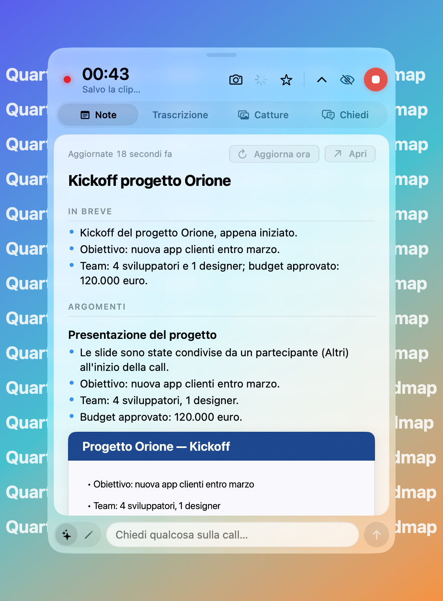
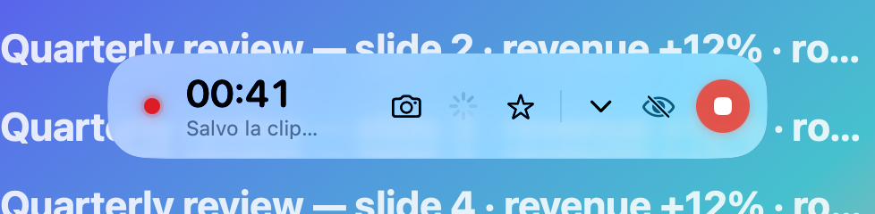
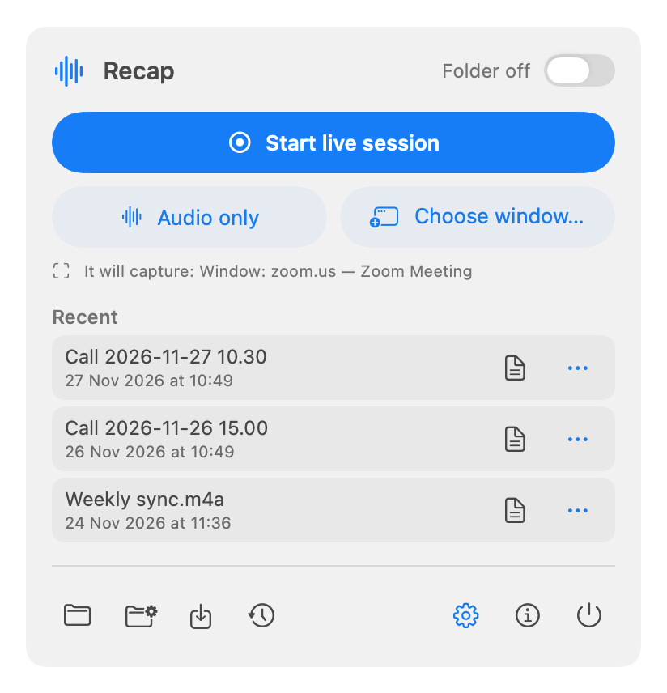
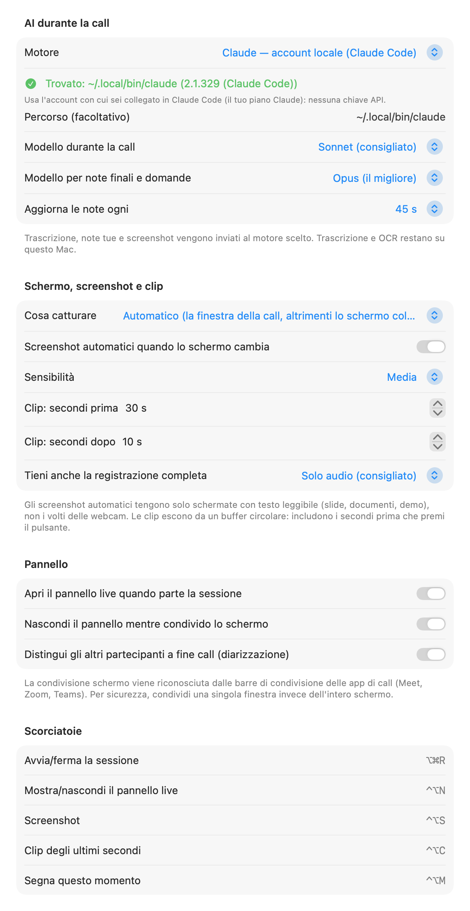
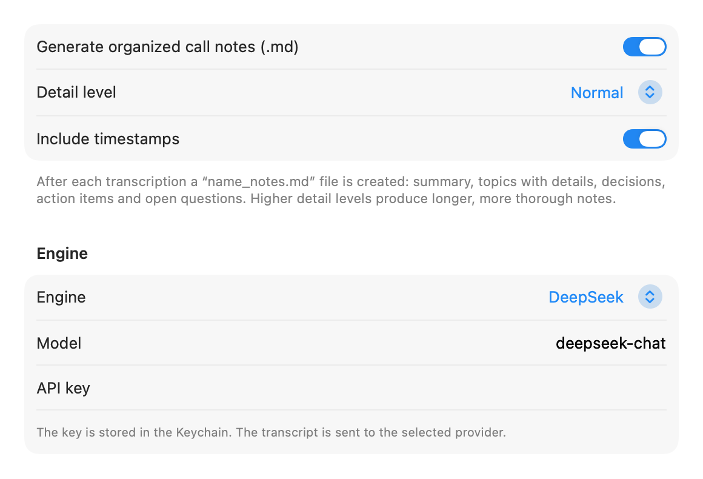
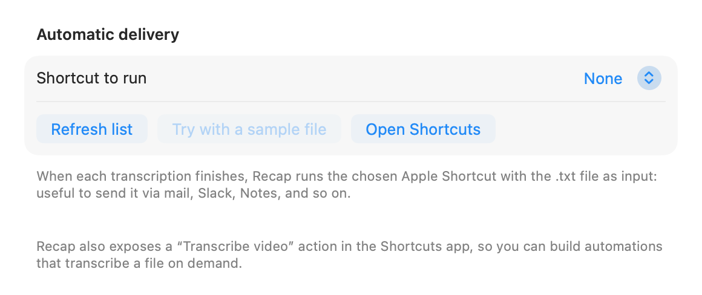
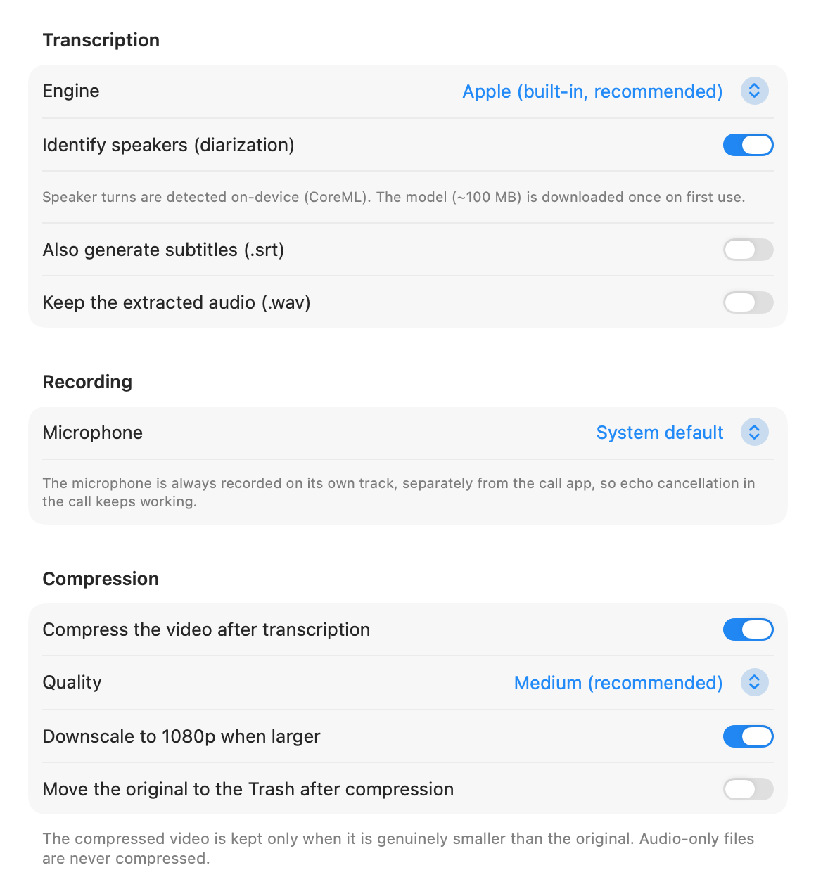
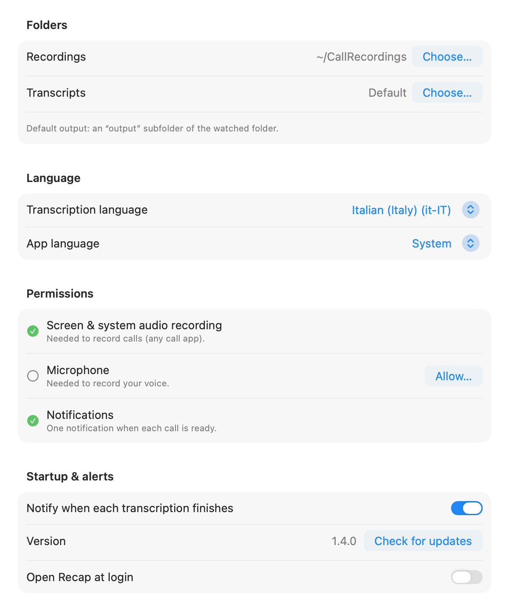

# Recap

*[Italiano](README.it.md)*

A macOS menu bar app that takes notes of your calls while they happen: real-time transcription, screenshots of what gets shared, short clips, and AI notes kept up to date during the meeting. Transcription and OCR run on-device.

It also works after the fact: drop a video or audio file into a watched folder and Recap produces a transcript, organized Markdown notes, and an HEVC-compressed copy of the video.

*Recap was called CallT up to version 1.3.2. On first launch it imports CallT's settings and history; API keys are picked up from the Keychain the first time they are needed.*

## Live session

Start a session (**Start live session** or ⌥⌘R) when the call begins. Recap:

- **transcribes while you talk**, keeping your voice ("Me", from the microphone) apart from everyone else ("Others", from system audio); on-device diarization tells the other participants apart at the end;
- **captures the call window** (Zoom, Teams, Meet in the browser…, or the screen under the pointer) and **takes a screenshot by itself** whenever the shared screen changes — only screens with readable text (slides, documents, demos), with on-device OCR;
- keeps a **rolling buffer** for **clips**: ⌃⌥C saves the last 30 s plus the next 10 s, no full video needed (optional);
- **writes the notes as the call goes**, with Claude seeing both transcript and screenshots; a final pass (Opus) produces the complete document with the images placed where they matter;
- shows a translucent **floating panel** (Liquid Glass): compact (timer and quick actions) or expanded (notes, transcript, captures, a chat to ask questions or add your own notes). Draggable, hidden with ⌃⌥N or from the menu, hidden automatically while you share your screen, and excluded from captures;
- saves everything in one folder per call: `…_notes.md` (with `assets/` for images and clips), transcript, `session.json` and optionally the full recording.

**AI engines**: *Claude — local account* uses the `claude` CLI already signed in to your plan (no API key); alternatively the Claude API, the notes engine (e.g. DeepSeek, text only: screenshots arrive as OCR), or no AI at all.

Shortcuts: ⌥⌘R start/stop · ⌃⌥N panel · ⌃⌥S screenshot · ⌃⌥C clip · ⌃⌥M mark the moment.

| Panel | Compact |
|---|---|
|  |  |

Testing without a call: `Recap --live-replay recording.mp4 [--speed 2] [--live-test-actions] [--quit-after-session]` replays a file as if it were a call in progress.

## Features

- **Call recording** (ScreenCaptureKit): system audio from *any* call tool (Zoom, Meet, Teams…) plus your microphone, always on its own track through AVCapture so the call app's echo cancellation is never touched — with screen video, or audio-only.
- **Speaker identification (diarization)** — fully on-device (CoreML via FluidAudio): transcripts become "Speaker 1/2/…" turns and the notes attribute positions and statements to each participant, using real names when the conversation reveals them.
- **On-device transcription** with the macOS 26 speech engine (the same one used by Notes and Voice Memos) — no external dependencies. Optionally uses `whisper-cli` + a ggml model when installed.
- **Organized notes (.md)**: after each transcription — summary, topics with details and timestamps, decisions, action items, open questions, written in the language of the call. Engines: Apple Intelligence on-device (default, free, map/reduce for long calls), Claude through the local Claude Code login, Claude API, OpenRouter, DeepSeek, local Ollama, or any OpenAI-compatible endpoint (API keys live in the Keychain).
- **Smart HEVC compression**: bitrate computed from the source (never above 65% of the original), optional 1080p downscale, and a guarantee the compressed file is kept only when genuinely smaller.
- **Apple Shortcuts, both ways**: run a Shortcut with the transcript when a call finishes (delivery via mail/Slack/Notes/…), and a "Transcribe video" action exposed to the Shortcuts app (App Intents).
- **Folder watching** with a persistent registry (no double processing across restarts), serial queue, notifications, persistent settings, English/Italian UI.
- Audio-only files (m4a, mp3, wav, aiff, flac) are transcribed too — voice memos welcome.
- MKV supported when ffmpeg is installed (AVFoundation cannot read it).

## Screenshots

| Menu | Live settings |
|---|---|
|  |  |

| Notes engines | Automation |
|---|---|
|  |  |

| Processing | General |
|---|---|
|  |  |

Screenshots are rendered straight from the real UI: `Recap --render-screenshots <dir>`.

## Requirements

- macOS 26 (Tahoe) or later. Xcode 26 to build.

## Install

Download `Recap.dmg` from the [releases](https://github.com/anhonestboy/Recap/releases) and drag Recap to Applications — or use Homebrew:

```sh
brew install --cask anhonestboy/tap/recap
```
 On first launch macOS blocks unsigned apps: open **System Settings → Privacy & Security → Open Anyway** (one time only). To record calls you will also be asked for Screen & System Audio Recording and Microphone permissions.

Or build from source:

```sh
scripts/build.sh              # arm64 build → build.noindex/Recap.app
scripts/build.sh --universal  # arm64 + x86_64
scripts/package.sh            # universal build + distributable build.noindex/Recap.dmg
```

The build is a manual `swiftc` pipeline (compile, bundle, extract App Intents metadata with `appintentsmetadataprocessor`, ad-hoc sign): it does not require `xcodebuild`. To work in Xcode, `xcodegen generate` (requires `brew install xcodegen`) produces `Recap.xcodeproj` from `project.yml`.

The app icon is regenerated with `swift scripts/make_icon.swift Resources` (same SF "waveform" glyph used in the menu bar).

## Privacy

Recording, transcription, OCR, diarization and compression always run on your Mac. Text and images leave the machine only for the AI engine you choose: during a live session the transcript, your own notes and the screenshots go to it (Claude via your Claude Code login or the API; text-only engines receive OCR text instead of images); for file notes, the transcript goes to the selected notes engine. Pick "No AI" or Apple Intelligence to keep everything local. API keys are stored in the macOS Keychain.

## Project layout

```
Sources/
  RecapApp.swift            entry point (MenuBarExtra + Settings scene)
  AppState.swift            central state, serial queue, folder monitoring
  Pipeline.swift            orchestration: audio → transcript → notes → compression → delivery
  Settings.swift            UserDefaults keys/values
  FolderWatcher.swift       folder watching (kqueue) + file-stability wait
  VideoCompressor.swift     HEVC via AVAssetReader/Writer, size guarantee
  AudioExtractor.swift      M4A/WAV extraction via AVFoundation
  FFmpegHelper.swift        MKV path (only when ffmpeg is installed)
  ProcessRunner.swift       subprocess with timeout and line streaming
  ProcessedRegistry.swift   persistent registry of processed files
  ShortcutRunner.swift      `shortcuts` CLI integration
  Notifier.swift, LogStore.swift, Job.swift
  Live/                     live session: capture sources, streaming transcription, frame analyzer
                            (screenshots + OCR), clip ring buffer, writers, AI engines, prompts
  Recording/                MicCapture (AVCapture), hotkeys, window picker
  Notes/                    notes generator + engines (Apple, Claude, OpenAI-compatible)
  Transcription/            Transcript (+SRT), AppleTranscriber, WhisperTranscriber
  UI/                       PopoverView, LivePanel, MarkdownView, SettingsView
  Intents/                  "Transcribe video" App Intent + AppShortcutsProvider
Resources/                  icon + localizations (en base, it)
scripts/                    build.sh, package.sh, make_icon.swift
```

## Credits

Created by **Maurizio Palumbo** ([werootbox](mailto:hello@werootbox.com)).

Built with [Claude Code](https://claude.com/claude-code) (Anthropic). Recap stands on excellent shoulders:

- **Apple frameworks** — ScreenCaptureKit (recording), Speech/SpeechAnalyzer (transcription), FoundationModels/Apple Intelligence (on-device notes), AVFoundation (audio/video processing), App Intents (Shortcuts)
- **[FluidAudio](https://github.com/FluidInference/FluidAudio)** (Apache-2.0) — on-device speaker diarization
- **[whisper.cpp](https://github.com/ggml-org/whisper.cpp)** — optional transcription engine
- **[ffmpeg](https://ffmpeg.org)** — optional MKV support
- Optional notes providers: [Anthropic](https://www.anthropic.com), [OpenRouter](https://openrouter.ai), [DeepSeek](https://deepseek.com), [Ollama](https://ollama.com)

## License

MIT — see [LICENSE](../LICENSE).
